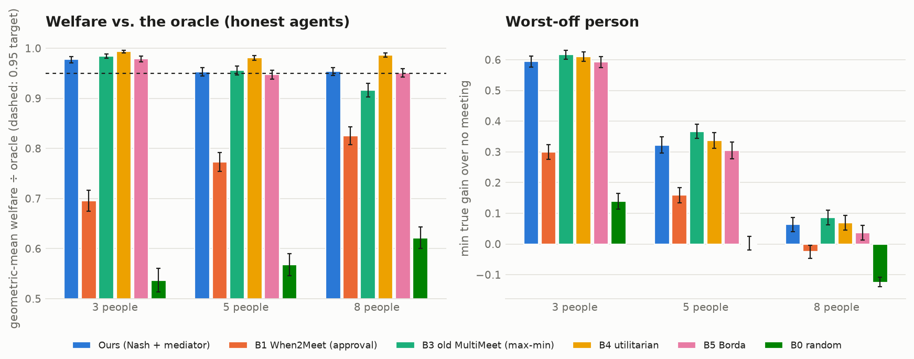
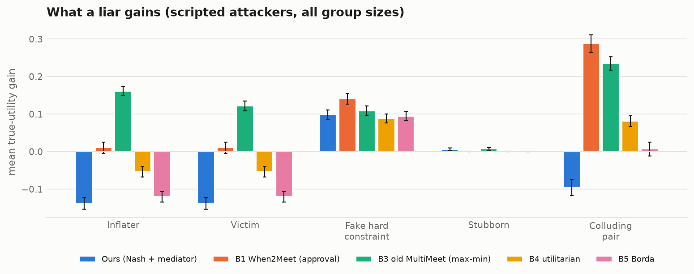
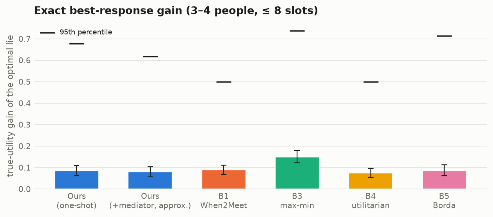

# MeetMind

Multi-agent AI scheduling platform. See [SPEC.md](./SPEC.md) for the full product and architecture spec.

## User flow

A linear, no-login wizard: **Create event → Share link → Upload calendar → Talk to your agent → Negotiation**.

1. **Create** — enter a title, get an event.
2. **Share** — copy an invite link (`/join/:inviteCode`); anyone who opens it joins the event and goes through their own onboarding.
3. **Calendar** — upload an `.ics` export (or skip); parsed into hard-block events for the Personal Agent.
4. **Agent** — a chat with your Personal Agent where natural-language preferences get parsed and stored.
5. **Negotiate** — triggers the negotiation; a WebSocket streams live Personal Agent / Mediator Agent events, ending in a decision with a satisfaction breakdown.

Identity is a lightweight anonymous guest user created on first visit and cached in `localStorage` — no accounts.

## Structure

- `backend/` — FastAPI app: models, `/events` (create/share/join), calendar upload, Personal/Mediator agent logic (Claude API), negotiation orchestration, WebSocket live-negotiation feed.
- `frontend/` — React + TypeScript + Vite + Tailwind app implementing the five-step flow above.

## Running locally

### Backend

```bash
cd backend
python3 -m venv venv && source venv/bin/activate
pip install -r requirements.txt
cp .env.example .env  # fill in ANTHROPIC_API_KEY (required for agent/negotiation calls)
uvicorn app.main:app --reload
```

Uses SQLite by default (`backend/meetmind.db`, gitignored) — no database setup needed. Set `DATABASE_URL` in `.env` to point at Postgres instead if you want that.

### Frontend

```bash
cd frontend
npm install
cp .env.example .env
npm run dev
```

Frontend expects the backend at `http://localhost:8000` (configurable via `.env`).

## Status

MVP: the full linear flow above works end-to-end, including live WebSocket negotiation events. Without `ANTHROPIC_API_KEY` set, event/group creation, sharing, joining, and calendar upload all work — only the agent preference-parsing (falls back to a generic acknowledgement) and the negotiation call itself (errors) need the key. Stretch features (nudges, recurring meetings, location-aware scheduling, analytics, real calendar OAuth) are not yet implemented — see SPEC.md.

## How the negotiation works

The full design and every citation trace back to [docs/research/negotiation-layer.md](docs/research/negotiation-layer.md); the evaluation is in [docs/eval/](docs/eval/RESULTS.md).

### The solver decides, the LLM communicates

```
what people say ──LLM──▶ typed rules ──code──▶ utilities ──solver──▶ the pick
                                                    ▲                    │
                          one structured move ──────┘     LLM explains ◀─┘
                     (accept | flex(rule, weight) | hold)
```

- **Hard constraints are code.** Busy calendar blocks and rules a person calls absolute remove slots before anything else runs. Every pick in the evaluation respected them.
- **Utilities come from rules, not scores.** The personal agent turns "ideally around 2pm, Fridays are rough" into typed rules once. Code computes each person's utility for every slot from those rules and from their movable commitments. No agent ever hands the solver a number. This is the "LLM translates, solver decides" split of Lawless et al. (2024).
- **The pick is the Nash product** over the remaining slots: argmax Σ log(0.05 + u_i − d_i), with leximin breaking ties. Nash (1950) is invariant to how each person uses their scale, and maximum Nash welfare is Pareto-optimal and fair on discrete outcomes (Caragiannis et al. 2019). Utilities are rank-normalized (Borda) first, so nobody can win by shouting.
- **Mediated single text, monotonic concessions.**
  - The solver drafts a time.
  - The mediator asks the one person whose concession would raise the Nash product most.
  - That person's agent answers with exactly one structured move: accept, flex a rule's weight, or hold. Code rejects any flex that raises a weight back or goes below the flexibility the person allowed.
  - At most 3 rounds, in the spirit of Endriss (2006). The final pick is the solver's, on the final reports.
- **The LLM only talks.** It renders the mediator's ask and the explanation. A faithfulness check confirms that the explanation names the person the decision actually turned on. Free text from agents never reaches the solver.

<!-- verify: Nash (1950) is marked ○ (cited from memory) in docs/research/negotiation-layer.md; check doi:10.2307/1907266 and the pages before publishing. -->

### Evaluation

- **Method.**
  - 1,530 synthetic instances: 3, 5 and 8 people at 30–70% calendar density, a third of them across time zones.
  - Hidden ground-truth preferences, scored against the truth, never against reports. This is the scorable-game design of Abdelnabi et al. (2024).
  - Thresholds were [preregistered](docs/eval/preregistration.md) before running.
- **Run it:** `cd backend && venv/bin/python -m eval.run`.





What held up, and what didn't:

- **Quality.** The new rule reaches 95–98% of the oracle's welfare and beats When2Meet-style approval at every group size. With honest agents it does **not** beat the old max-min rule: it is worse on the worst-off person at every size. A plain utilitarian sum scored higher still.
- **Robustness.** This is the gain. Exaggerating preferences backfires under the new rule: liars lose 0.14 on average, and 5% gain anything. Under the old rule they gain 0.16, and 46% gain. A colluding pair also loses instead of gaining 0.23. Against a liar who computes the exact best lie, the old rule gives up 0.149 on average and the new rule 0.085.
- **Not solved.** Declaring a soft dislike as a hard constraint pays about the same under every rule, roughly +0.1. The report's proposed fix, budgeted hard constraints, is not built yet. The mediator rounds add no measurable welfare in this agent model; their value here is a visible, explained process.
- **Tried after the first results ([Amendment 2](docs/eval/preregistration.md), with its decision rule fixed before running).**
  - Keeping intensity under an L2 budget lifts honest quality to 0.988 of the oracle, above the old rule. But lying starts to pay again, especially for colluding pairs, so the rank-based default stays.
  - A 2-token budget on declared hard constraints did not reduce the fake-constraint attack, because two well-chosen rules already remove most of the week.
- **Not tested.** LLM baselines and LLM attackers (persuasion, prompt injection) need an API key. The code is in `backend/eval/llm.py`.

### What we don't claim

By Gibbard–Satterthwaite, no deterministic, non-dictatorial rule over three or more options is strategy-proof. MultiMeet isn't either, so we measure how much a liar gains instead of claiming they can't. In the exact best-response test, 27% of deviators had some profitable lie.
<!-- verify: Gibbard (1973) and Satterthwaite (1975) are marked ○ (cited from memory) in docs/research/negotiation-layer.md; check the DOIs and pages. -->

### References

1. Nash, J. F. (1950). The Bargaining Problem. *Econometrica* 18(2):155–162. doi:10.2307/1907266 <!-- verify: ○ in the research report -->
2. Endriss, U. (2006). Monotonic Concession Protocols for Multilateral Negotiation. *AAMAS 2006*, 392–399. doi:10.1145/1160633.1160702
3. Caragiannis, I., Kurokawa, D., Moulin, H., Procaccia, A. D., Shah, N. & Wang, J. (2019). The Unreasonable Fairness of Maximum Nash Welfare. *ACM TEAC* 7(3), 12. doi:10.1145/3355902
4. Abdelnabi, S., Gomaa, A., Sivaprasad, S., Schönherr, L. & Fritz, M. (2024). Cooperation, Competition, and Maliciousness: LLM-Stakeholders Interactive Negotiation. *NeurIPS 2024 Datasets & Benchmarks*. arXiv:2309.17234
5. Lawless, C., Schoeffer, J., Le, L., Rowan, K., Sen, S., St. Hill, C., Suh, J. & Sarrafzadeh, B. (2024). "I Want It That Way": Enabling Interactive Decision Support Using Large Language Models and Constraint Programming. *ACM TiiS* 14(3), 22. doi:10.1145/3685053
