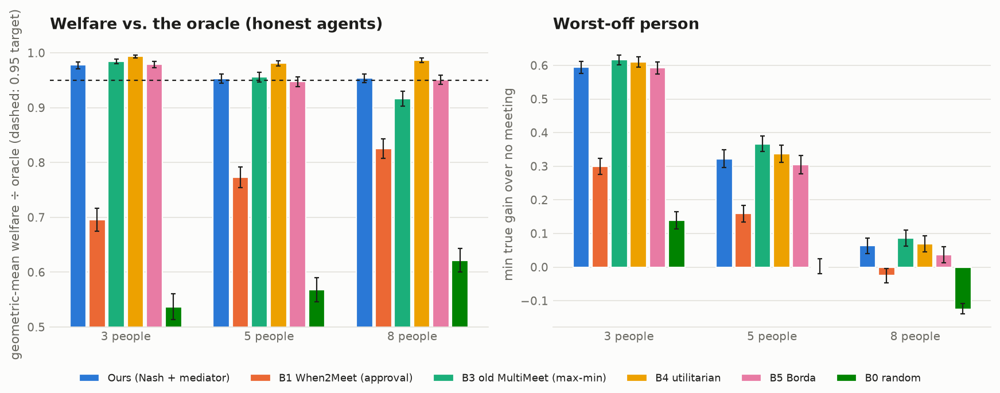
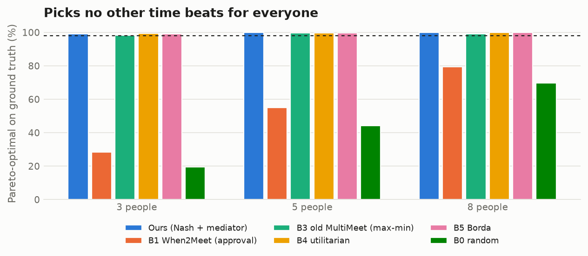
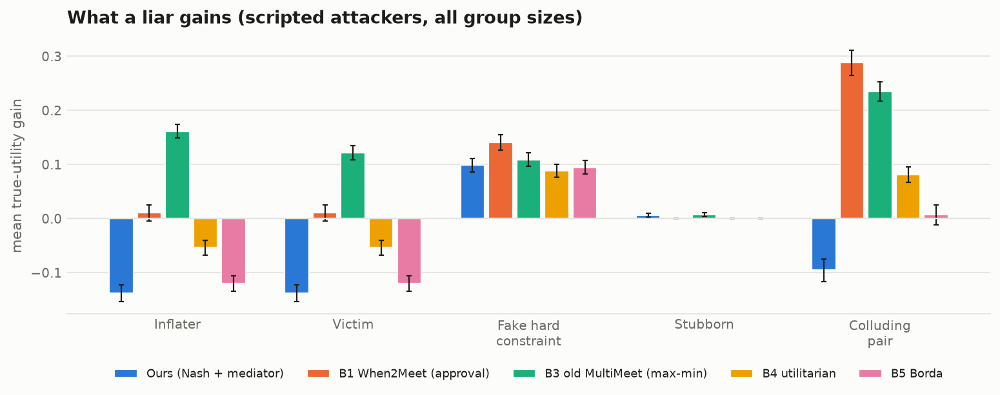
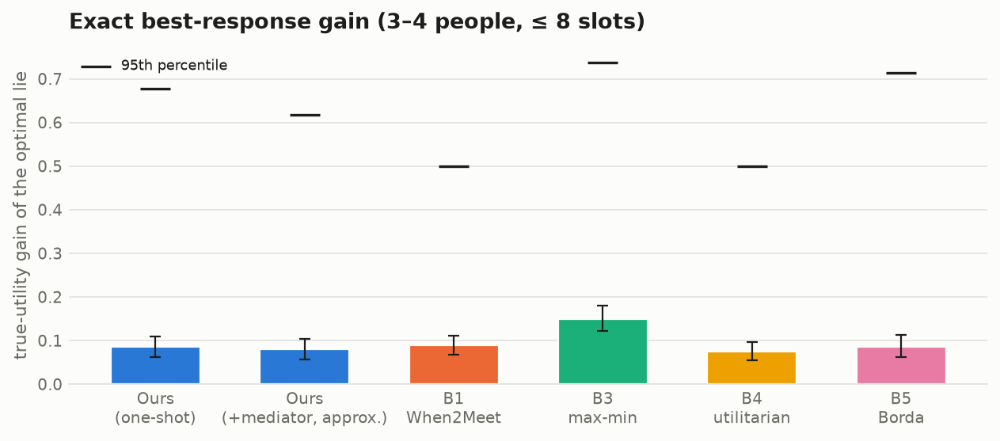

# Evaluation results

Generated by `cd backend && venv/bin/python -m eval.run`, against the thresholds in
[preregistration.md](preregistration.md). Simulated agents only (`MULTIMEET_AGENTS=simulated`).
LLM baselines and attackers: not run (no --llm). Runtime 4.1 min.

## Against the preregistered thresholds

| # | n | Claim | Result | |
|---|---|---|---|---|
| Q1 | 3 | Ours mean ratio to oracle ≥ 0.95 | 0.978 | **pass** |
| Q1 | 5 | Ours mean ratio to oracle ≥ 0.95 | 0.953 | **pass** |
| Q1 | 8 | Ours mean ratio to oracle ≥ 0.95 | 0.954 | **pass** |
| Q2 | 3 | Ours > B1 on Nash welfare | Δ +1.237 [+1.120, +1.350]; marginal CIs separate | **pass** |
| Q2 | 3 | Ours > B1 on min utility | Δ +0.296 [+0.269, +0.321]; marginal CIs separate | **pass** |
| Q2 | 3 | Ours > B3 on Nash welfare | Δ -0.028 [-0.051, -0.006]; marginal CIs overlap | **MISS** |
| Q2 | 3 | Ours > B3 on min utility | Δ -0.022 [-0.030, -0.014]; marginal CIs overlap | **MISS** |
| Q2 | 5 | Ours > B1 on Nash welfare | Δ +1.263 [+1.113, +1.417]; marginal CIs separate | **pass** |
| Q2 | 5 | Ours > B1 on min utility | Δ +0.164 [+0.141, +0.188]; marginal CIs separate | **pass** |
| Q2 | 5 | Ours > B3 on Nash welfare | Δ -0.009 [-0.082, +0.073]; marginal CIs overlap | **MISS** |
| Q2 | 5 | Ours > B3 on min utility | Δ -0.044 [-0.057, -0.032]; marginal CIs overlap | **MISS** |
| Q2 | 8 | Ours > B1 on Nash welfare | Δ +1.430 [+1.210, +1.662]; marginal CIs separate | **pass** |
| Q2 | 8 | Ours > B1 on min utility | Δ +0.089 [+0.071, +0.107]; marginal CIs separate | **pass** |
| Q2 | 8 | Ours > B3 on Nash welfare | Δ +0.436 [+0.272, +0.611]; marginal CIs overlap | **pass** |
| Q2 | 8 | Ours > B3 on min utility | Δ -0.023 [-0.034, -0.011]; marginal CIs overlap | **MISS** |
| E1 | 3 | Ours Pareto-optimal ≥ 98% | 99.0% | **pass** |
| E1 | 5 | Ours Pareto-optimal ≥ 98% | 100.0% | **pass** |
| E1 | 8 | Ours Pareto-optimal ≥ 98% | 100.0% | **pass** |
| R1 | all | inflater: Ours gain ≤ 0.5 × B3 | B3 median 0 → means: -0.138 vs B3 0.161 | **pass** |
| R1 | all | victim: Ours gain ≤ 0.5 × B3 | B3 median 0 → means: -0.138 vs B3 0.122 | **pass** |
| R1 | all | fakehard: Ours gain ≤ 0.5 × B3 | B3 median 0 → means: 0.099 vs B3 0.109 | **MISS** |
| R2 | 3–4 | Exact BR gain: Ours-oneshot below B3-oneshot | mean 0.085 (p95 0.677, max 1.000); Δ -0.064 [-0.093, -0.034] | **pass** |
| R3 | — | Injection / persuasion gain ≈ 0 | not run (needs an LLM); structural unit test only | — |
| S1 | all | 0 hard-constraint violations | 0 | **pass** |
| C1 | 3 | Ours median rounds ≤ 2 | 0 (median runtime 7 ms) | **pass** |
| C1 | 5 | Ours median rounds ≤ 2 | 1 (median runtime 13 ms) | **pass** |
| C1 | 8 | Ours median rounds ≤ 2 | 2 (median runtime 20 ms) | **pass** |
| F1 | all | ≥ 95% explanations name the decisive person (simulated explainer) | 100.0% | **pass** |
| T1 | all | Translation match rate (simulated parser), reported | 94.9% kind+value; 82.7% incl. hard/soft | — |

## Instances

| n | kept | dropped | multi-time-zone | feasible slots (median, range) |
|---|---|---|---|---|
| 3 | 510 | 0 | 170 | 24 (6–52) |
| 5 | 510 | 0 | 170 | 16 (2–50) |
| 8 | 510 | 0 | 170 | 10 (2–35) |

## Quality with honest agents (mean, 95% bootstrap CI)

| n | mechanism | ratio to oracle | min gain | utilitarian | proportional | Pareto-optimal | rounds (median) |
|---|---|---|---|---|---|---|---|
| 3 | B0 | 0.537 [0.513, 0.560] | +0.140 [+0.114, +0.165] | 0.615 | 74.9% | 19.6% | 0 |
| 3 | B1 | 0.695 [0.675, 0.717] | +0.299 [+0.276, +0.324] | 0.720 | 88.9% | 28.4% | 0 |
| 3 | B3 | 0.985 [0.980, 0.988] | +0.616 [+0.601, +0.631] | 0.909 | 99.5% | 98.4% | 1 |
| 3 | B4 | 0.993 [0.990, 0.996] | +0.610 [+0.594, +0.626] | 0.919 | 99.2% | 99.4% | 0 |
| 3 | B5 | 0.979 [0.973, 0.985] | +0.593 [+0.575, +0.610] | 0.912 | 98.9% | 99.2% | 0 |
| 3 | Ours | 0.978 [0.971, 0.983] | +0.595 [+0.577, +0.612] | 0.911 | 98.9% | 99.0% | 0 |
| 3 | Ours-d | 0.982 [0.976, 0.986] | +0.601 [+0.583, +0.618] | 0.912 | 99.0% | 99.2% | 1 |
| 3 | Ours-oneshot | 0.981 [0.976, 0.986] | +0.599 [+0.581, +0.616] | 0.912 | 99.1% | 99.4% | 0 |
| 3 | Ours-nonorm | 0.974 [0.966, 0.981] | +0.591 [+0.571, +0.610] | 0.911 | 98.2% | 98.8% | 2 |
| 3 | Ours-maxmin | 0.972 [0.966, 0.978] | +0.601 [+0.584, +0.618] | 0.904 | 99.0% | 98.6% | 0 |
| 5 | B0 | 0.568 [0.546, 0.590] | +0.002 [-0.019, +0.025] | 0.601 | 77.9% | 44.3% | 0 |
| 5 | B1 | 0.773 [0.754, 0.792] | +0.159 [+0.134, +0.184] | 0.728 | 90.9% | 54.9% | 0 |
| 5 | B3 | 0.956 [0.947, 0.965] | +0.367 [+0.344, +0.390] | 0.827 | 96.9% | 99.6% | 1 |
| 5 | B4 | 0.981 [0.976, 0.985] | +0.337 [+0.312, +0.362] | 0.853 | 95.9% | 99.6% | 0 |
| 5 | B5 | 0.947 [0.938, 0.956] | +0.305 [+0.277, +0.331] | 0.842 | 94.4% | 99.8% | 0 |
| 5 | Ours | 0.953 [0.945, 0.961] | +0.323 [+0.296, +0.348] | 0.840 | 95.5% | 100.0% | 1 |
| 5 | Ours-d | 0.917 [0.897, 0.935] | +0.360 [+0.338, +0.383] | 0.808 | 94.0% | 100.0% | 2 |
| 5 | Ours-oneshot | 0.956 [0.947, 0.964] | +0.330 [+0.305, +0.357] | 0.839 | 95.7% | 99.8% | 0 |
| 5 | Ours-nonorm | 0.949 [0.939, 0.958] | +0.312 [+0.285, +0.340] | 0.839 | 94.5% | 99.8% | 2 |
| 5 | Ours-maxmin | 0.938 [0.928, 0.948] | +0.333 [+0.308, +0.358] | 0.824 | 95.9% | 98.4% | 0 |
| 8 | B0 | 0.622 [0.601, 0.644] | -0.125 [-0.140, -0.109] | 0.595 | 76.3% | 69.8% | 0 |
| 8 | B1 | 0.826 [0.808, 0.843] | -0.025 [-0.047, -0.004] | 0.712 | 85.7% | 79.4% | 0 |
| 8 | B3 | 0.917 [0.902, 0.930] | +0.087 [+0.062, +0.110] | 0.752 | 90.6% | 99.0% | 2 |
| 8 | B4 | 0.986 [0.982, 0.990] | +0.070 [+0.045, +0.093] | 0.798 | 90.9% | 100.0% | 0 |
| 8 | B5 | 0.951 [0.943, 0.959] | +0.037 [+0.012, +0.060] | 0.786 | 89.7% | 100.0% | 0 |
| 8 | Ours | 0.954 [0.945, 0.962] | +0.064 [+0.040, +0.087] | 0.781 | 91.0% | 100.0% | 2 |
| 8 | Ours-d | 0.688 [0.651, 0.724] | +0.141 [+0.121, +0.159] | 0.599 | 84.9% | 99.8% | 2 |
| 8 | Ours-oneshot | 0.957 [0.949, 0.964] | +0.069 [+0.045, +0.092] | 0.782 | 91.1% | 100.0% | 0 |
| 8 | Ours-nonorm | 0.949 [0.939, 0.958] | +0.048 [+0.023, +0.071] | 0.781 | 89.2% | 100.0% | 2 |
| 8 | Ours-maxmin | 0.915 [0.902, 0.927] | +0.078 [+0.054, +0.102] | 0.755 | 90.5% | 99.2% | 0 |

## Manipulation (pooled over n; gain is the liar's true-utility change)

| attacker | mechanism | mean gain [95% CI] | median | share gaining | harm to honest | price of strategic behaviour |
|---|---|---|---|---|---|---|
| inflater | B1 | +0.010 [-0.005, +0.025] | +0.000 | 18.1% | -0.008 | 1.096 |
| inflater | B3 | +0.161 [+0.149, +0.175] | +0.000 | 46.2% | -0.220 | 1.696 |
| inflater | B4 | -0.053 [-0.068, -0.041] | +0.000 | 15.3% | -0.062 | 1.192 |
| inflater | B5 | -0.120 [-0.135, -0.105] | +0.000 | 4.6% | -0.002 | 1.109 |
| inflater | Ours | -0.138 [-0.153, -0.123] | +0.000 | 5.2% | +0.005 | 1.109 |
| inflater | Ours-d | -0.158 [-0.173, -0.144] | +0.000 | 3.4% | +0.026 | 1.102 |
| inflater | Ours-oneshot | -0.144 [-0.160, -0.130] | +0.000 | 4.1% | +0.010 | 1.109 |
| inflater | Ours-nonorm | -0.017 [-0.031, -0.004] | +0.000 | 18.8% | -0.075 | 1.223 |
| inflater | Ours-maxmin | -0.156 [-0.173, -0.141] | +0.000 | 4.4% | +0.013 | 1.107 |
| victim | B1 | +0.010 [-0.005, +0.025] | +0.000 | 18.1% | -0.008 | 1.096 |
| victim | B3 | +0.122 [+0.108, +0.135] | +0.000 | 41.2% | -0.188 | 1.590 |
| victim | B4 | -0.053 [-0.068, -0.041] | +0.000 | 15.3% | -0.062 | 1.192 |
| victim | B5 | -0.120 [-0.135, -0.105] | +0.000 | 4.6% | -0.002 | 1.109 |
| victim | Ours | -0.138 [-0.153, -0.123] | +0.000 | 5.2% | +0.005 | 1.109 |
| victim | Ours-d | -0.158 [-0.173, -0.144] | +0.000 | 3.4% | +0.026 | 1.102 |
| victim | Ours-oneshot | -0.144 [-0.160, -0.130] | +0.000 | 4.1% | +0.010 | 1.109 |
| victim | Ours-nonorm | -0.210 [-0.229, -0.194] | +0.000 | 0.4% | +0.024 | 1.135 |
| victim | Ours-maxmin | -0.156 [-0.173, -0.141] | +0.000 | 4.4% | +0.013 | 1.107 |
| fakehard | B1 | +0.140 [+0.126, +0.155] | +0.000 | 23.8% | -0.002 | 0.969 |
| fakehard | B3 | +0.109 [+0.097, +0.122] | +0.000 | 27.1% | -0.037 | 1.081 |
| fakehard | B4 | +0.089 [+0.077, +0.100] | +0.000 | 20.0% | -0.040 | 1.066 |
| fakehard | B5 | +0.095 [+0.082, +0.107] | +0.000 | 17.1% | -0.036 | 1.052 |
| fakehard | Ours | +0.099 [+0.086, +0.111] | +0.000 | 19.3% | -0.038 | 1.060 |
| fakehard | Ours-d | +0.052 [+0.042, +0.062] | +0.000 | 13.1% | -0.024 | 1.256 |
| fakehard | Ours-oneshot | +0.097 [+0.084, +0.109] | +0.000 | 19.5% | -0.039 | 1.066 |
| fakehard | Ours-nonorm | +0.069 [+0.059, +0.081] | +0.000 | 9.6% | -0.020 | 1.024 |
| fakehard | Ours-maxmin | +0.107 [+0.095, +0.119] | +0.000 | 23.4% | -0.031 | 1.058 |
| stubborn | B1 | +0.000 [+0.000, +0.000] | +0.000 | 0.0% | +0.000 | 1.000 |
| stubborn | B3 | +0.007 [+0.004, +0.011] | +0.000 | 2.9% | -0.003 | 1.007 |
| stubborn | B4 | +0.000 [+0.000, +0.000] | +0.000 | 0.0% | +0.000 | 1.000 |
| stubborn | B5 | +0.000 [+0.000, +0.000] | +0.000 | 0.0% | +0.000 | 1.000 |
| stubborn | Ours | +0.006 [+0.003, +0.009] | +0.000 | 1.2% | -0.001 | 1.000 |
| stubborn | Ours-d | +0.004 [+0.002, +0.006] | +0.000 | 1.2% | -0.004 | 1.034 |
| stubborn | Ours-oneshot | +0.000 [+0.000, +0.000] | +0.000 | 0.0% | +0.000 | 1.000 |
| stubborn | Ours-nonorm | +0.007 [+0.003, +0.012] | +0.000 | 2.2% | -0.003 | 1.003 |
| stubborn | Ours-maxmin | +0.005 [+0.003, +0.009] | +0.000 | 1.4% | -0.002 | 1.002 |
| pair | B1 | +0.288 [+0.265, +0.311] | +0.139 | 56.5% | -0.045 | 0.997 |
| pair | B3 | +0.234 [+0.217, +0.253] | +0.047 | 55.7% | -0.209 | 1.348 |
| pair | B4 | +0.081 [+0.067, +0.095] | +0.000 | 38.9% | -0.178 | 1.257 |
| pair | B5 | +0.007 [-0.012, +0.025] | +0.000 | 29.8% | -0.124 | 1.172 |
| pair | Ours | -0.095 [-0.117, -0.075] | +0.000 | 20.7% | -0.061 | 1.143 |
| pair | Ours-d | -0.149 [-0.171, -0.127] | +0.000 | 16.1% | +0.009 | 1.133 |
| pair | Ours-oneshot | -0.131 [-0.151, -0.109] | +0.000 | 17.2% | -0.038 | 1.146 |
| pair | Ours-nonorm | +0.149 [+0.134, +0.165] | +0.000 | 45.2% | -0.193 | 1.271 |
| pair | Ours-maxmin | -0.241 [-0.264, -0.218] | +0.000 | 9.9% | +0.025 | 1.183 |

## Exact best response (300 small instances, median 8 slots)

| mechanism | mean gain [95% CI] | 95th pct | max | share gaining |
|---|---|---|---|---|
| Ours-oneshot | 0.085 [0.062, 0.109] | 0.677 | 1.000 | 27.3% |
| Ours (approx.) | 0.081 [0.057, 0.104] | 0.618 | 1.000 | 25.7% |
| B5 | 0.087 [0.062, 0.113] | 0.713 | 1.000 | 23.7% |
| B3-oneshot | 0.149 [0.122, 0.179] | 0.738 | 1.000 | 41.7% |
| B4 | 0.075 [0.055, 0.096] | 0.500 | 1.000 | 29.0% |
| B1 | 0.089 [0.068, 0.111] | 0.500 | 1.000 | 33.7% |

## Other checks

- Hard-constraint violations across every run: 0.
- Old MultiMeet would have escalated (min raw score < 40) on 22.7% of honest instances; B3 above takes its top-ranked slot regardless.
- Translation (simulated parser) by rule kind: avoid_weekdays 100% (n=2449), buffer_minutes 100% (n=1477), day_weights 67% (n=2038), not_after 100% (n=1459), not_before 100% (n=1763), time_of_day 100% (n=4143).

## Charts

## Reading the results honestly

Written after the run. Everything above is generated; this section interprets it. Where
something here was not preregistered, it says so.

**Scorecard.** Of the preregistered checks, these passed: Q1, E1, R1 for inflater and
victim, R2, S1, C1 and F1. These missed: Q2 against B3 (5 of 6 comparisons) and R1 for
the fake hard constraint. These were not run: R3, B2 and B6 (no API key). T1 is
reported.

1. **Quality.** Ours reaches 0.978, 0.953 and 0.954 of the oracle's welfare at n = 3,
   5 and 8 (Q1 passes).
   - At n = 5 and n = 8 the margin is thin: the 95% CIs reach down to 0.945.
   - Ours clearly beats When2Meet-style approval (B1) on every measure at every n.
2. **Ours does not beat the old max-min rule (B3) with honest agents (Q2: 5 of 6
   comparisons missed).**

   | n | Nash welfare | Min utility |
   |---|---|---|
   | 3 | slightly worse | worse |
   | 5 | tied | worse |
   | 8 | clearly better | worse |

   The min-utility deficits are 0.02–0.04 at every n. The new rule's case therefore
   rests on robustness, not on quality with honest agents.
3. **The plain utilitarian sum over range-normalized reports (B4) had the best welfare
   with honest agents.** It scored 0.993, 0.981 and 0.986 of the oracle, above Ours at
   every n.
   - Our reading: the ground truth is cardinal, and B4 sees nearly cardinal honest
     reports. Ours deliberately throws away intensity (Borda) so that liars can't shout.
   - That costs roughly 1.5 to 3 points of welfare when nobody lies: the distortion
     cost of rank-based elicitation (Boutilier et al. 2015)<!-- verify: Boutilier et al. 2015 is marked ○ (cited from memory) in docs/research/negotiation-layer.md; check the DOI and pages -->.
   - Not preregistered, and not run: whether Nash over range normalization keeps B4's
     honest quality while staying robust. The no-normalization ablation suggests
     robustness would suffer.
4. **Lying about intensity backfires under Ours (R1 passes for inflater and victim).**

   | Attacker | Liar's mean gain under Ours (share gaining) | Under B3 (share gaining) |
   |---|---|---|
   | Inflater | −0.138 (5%) | +0.161 (46%) |
   | Victim | −0.138 (5%) | +0.122 (41%) |
   | Colluding pair | −0.095 | B3 +0.234, B1 +0.288 |

   Honest people are not harmed under Ours; they are under B3 (−0.22 for the inflater).
   Normalization is what does this: without it (Ours-nonorm) the inflater breaks even,
   and the colluding pair gains +0.149.
5. **Faking a hard constraint still pays, about equally under every mechanism (R1
   misses).**
   - Ours +0.099 against B3 +0.109; every mechanism falls between +0.05 and +0.14.
   - The research report predicted this as the most dangerous lie. It recommends
     budgeted "hard tokens" for declared hard rules, which are not implemented. This is
     the most important open item.
6. **The mechanism is not strategy-proof, as Gibbard–Satterthwaite says it can't be.**
   - The exact best response under the one-shot Nash rule gains 0.085 on average,
     against 0.149 under max-min (R2 passes; Δ −0.064 [−0.093, −0.034]).
   - The worst case is not small: 27% of deviators have some profitable lie, the 95th
     percentile gain is 0.68, and the maximum is 1.0.
   - Utilitarian (0.075) and approval (0.089) are similar on average.
   - The supportable claim is "less manipulable than the old rule", not "hard to
     manipulate".
7. **The mediator adds no measurable welfare under this honest-agent model.**
   - Ours with the mediator scores 0.978, 0.953 and 0.954; the one-shot solver alone
     scores 0.981, 0.956 and 0.957. The CIs overlap.
   - Under rank normalization, conceding toward one's true weights rarely changes the
     Nash-optimal slot.
   - Here, the mediator's value is the visible, explained process, not a better pick.
     We say so rather than claim otherwise.
8. **Eliciting a disagreement point and requiring individual rationality (Ours-d) hurts
   at n = 8 (0.688).**
   - It declares "no slot is individually rational" too often.
   - The product keeps d = 0 on the common scale, as the report's option 3 allows, and
     says so in code.
9. **Other checks.**
   - Every pick was Pareto-optimal on ground truth in 99 to 100% of instances (E1).
   - The negotiation needed a median of 0, 1 and 2 rounds and 7 to 20 ms (C1).
   - Hard-constraint violations were 0 for every mechanism (S1). That holds by
     construction: every mechanism picks from the code-filtered set, and B2, the LLM
     baseline that might violate it, was not run.
10. **Faithfulness (F1) is 100% by construction.** The simulated explainer renders from
    the solver's reason. It says nothing about an LLM explainer.
11. **Translation (T1).**
    - The offline parser recovered the kind and value of 94.9% of rules, but only 67%
      of day-of-week dislikes.
    - Only 82.7% also got hard versus soft right. The sample phrases are often the same
      words for a hard rule and a soft one ("I'd rather be done by 5pm"), so
      firmness is not recoverable from the text.
    - An agent that hears a soft rule as hard has, in effect, made the fake hard
      constraint in item 5 by accident. The confirmation step in the report (the user
      approves the rules) matters.
12. **Not run, because there is no valid API key:** B2 (single LLM), B6 (free LLM
    negotiation), the persuader and injector attackers, and LLM translation. The code is
    in `backend/eval/llm.py` behind `--llm`.
    - The only evidence on injection is structural: a unit test shows that free text
      cannot reach the solver.
13. **The old product would have escalated** (no meeting) on 22.7% of honest instances.
    B3 above was credited with its top-ranked slot anyway, which favours the baseline.
14. **Instances.** Median feasible-set sizes were 24, 16 and 10 at n = 3, 5 and 8, after
    the preregistered Amendment 1 (calendars held at 40% hard). No instances were
    dropped.
